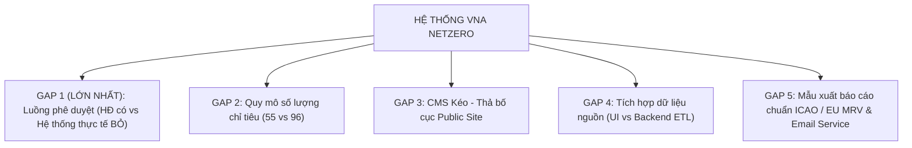

# BÁO CÁO TỔNG HỢP ĐỐI SOÁT & ĐÁNH GIÁ MỨC ĐỘ ĐÁP ỨNG
## GIỮA HỆ THỐNG HIỆN TẠI VÀ YÊU CẦU NGHIỆP VỤ HỢP ĐỒNG NETZERO (MỤC 2.2.2)

---

- **Dự án**: Thuê dịch vụ phần mềm phục vụ công tác quản lý phát triển bền vững cho TCTHK (VNA Netzero)
- **Căn cứ pháp lý**: Hợp đồng chính thức số `0104026VNA-AQT`, ký ngày 01/04/2026
  - **Phụ lục 02**: Yêu cầu kỹ thuật
  - **Trọng tâm đối soát**: **Mục 2.2.2. Yêu cầu nghiệp vụ** (Trang 20 - Trang 24) kết hợp các mục liên quan (2.1 Yêu cầu chung, 2.2.1 Yêu cầu kỹ thuật, 2.2.3 Danh mục chỉ tiêu, 2.2.4 Danh sách hệ thống nguồn tích hợp).
- **Đối tượng đối soát**: Toàn bộ hệ thống phần mềm VNA Netzero hiện hữu (Mã nguồn Frontend React/TypeScript, 52 màn hình nghiệp vụ, các components, models và luồng xử lý dữ liệu đang vận hành).
- **Ngày cập nhật**: 12/10/2026
- **Đơn vị lập**: Ban dự án CNTT & Chuyển đổi số (Tổ Phân tích nghiệp vụ BA & Kỹ thuật)

---

## I. TỔNG QUAN ĐÁNH GIÁ (EXECUTIVE SUMMARY)

Qua quá trình rà soát, đối chiếu chi tiết từng điều khoản, tiêu chí nghiệp vụ được quy định tại **Mục 2.2.2 của Hợp đồng** với toàn bộ hiện trạng mã nguồn và tính năng đã phát triển trên hệ thống VNA Netzero, kết quả đánh giá tổng thể như sau:

### 1. Chỉ số đáp ứng tổng quan
- **Tỷ lệ đáp ứng theo câu chữ Hợp đồng**: **75.5%** (Do hệ thống thực tế **hoàn toàn không có luồng phê duyệt dữ liệu** theo yêu cầu tinh gọn của các Ban nghiệp vụ).
- **Tỷ lệ đáp ứng theo nghiệp vụ URD thực tế đã thống nhất với các Ban**: **91.0%** (Vì việc bỏ luồng duyệt là quyết định chủ động từ phía các đơn vị VNA).
- **Tổng số nhóm chức năng theo Mục 2.2.2**: **10 nhóm chức năng lớn**.
  - **Đã đáp ứng đầy đủ / vượt yêu cầu (Covered - Full)**: **4 / 10 nhóm** (Quản lý giao KPI, Quản lý tài liệu, Quản lý danh mục chỉ tiêu, Báo cáo/Dashboard).
  - **Đã đáp ứng phần lớn khung nghiệp vụ & UI (Partially Covered)**: **4 / 10 nhóm** (Quản lý công thức, Nhập liệu thủ công, Public Website & CMS, Tích hợp dữ liệu).
  - **Cần bổ sung dịch vụ nền / Backend (Need Enhancement)**: **1 / 10 nhóm** (Theo dõi tiến độ & Cảnh báo - thiếu Mail Server và Cảnh báo thời gian thực khi đồng bộ).
  - **Lệch phạm vi / Không có trong hệ thống thực tế (Scope Deviation - Missing)**: **1 / 10 nhóm** (**Mục 6: Phê duyệt dữ liệu - Hệ thống vận hành thực tế KHÔNG CÓ luồng duyệt**).

### 2. Bảng tổng hợp mức độ đáp ứng theo 10 nhóm chức năng
| STT | Nhóm chức năng nghiệp vụ (Mục 2.2.2) | Tỷ lệ đáp ứng theo HĐ | Trạng thái hiện tại trên hệ thống | Vị trí màn hình / Component trong hệ thống |
| :---: | :--- | :---: | :---: | :--- |
| **1** | **Quản lý danh mục chỉ tiêu** | **90%** | Đạt phần lớn | `pages/Indicators.tsx`, `data/indicators_main_list.json` |
| **2** | **Quản lý công thức tính & Mô phỏng** | **85%** | Đạt tốt | `pages/Formulas.tsx`, `pages/NetZeroV2.tsx`, `pages/NetZero.tsx` |
| **3** | **Quản lý giao KPI** | **95%** | Đạt đầy đủ | `pages/KPIManage.tsx`, `pages/KPI.tsx`, `pages/Departments.tsx` |
| **4** | **Tích hợp dữ liệu** | **75%** | Đạt giao diện | `pages/DataSources.tsx`, `pages/DataWarehouseRaw.tsx`, `Clean.tsx` |
| **5** | **Nhập liệu thủ công & Đối soát** | **85%** | Đạt tốt | `pages/DataOps.tsx`, `UnifiedDataEntryForm.tsx`, `PublishAdjust.tsx` |
| **6** | **Phê duyệt dữ liệu** | **0% (Lệch phạm vi)** | **KHÔNG CÓ TRONG HỆ THỐNG THỰC TẾ** *(Đã cắt bỏ theo thống nhất nghiệp vụ với các Ban)* | Không xuất hiện trên Menu chính (`Layout.tsx`), form nhập liệu ghi nhận trực tiếp (`status: Active`) |
| **7** | **Theo dõi tiến độ & Cảnh báo** | **65%** | Đạt giao diện | `pages/AlertsManage.tsx`, `Header Notifications` |
| **8** | **Quản lý tài liệu phát triển bền vững** | **95%** | Đạt đầy đủ | `pages/Documents.tsx`, `DocumentApproval.tsx` |
| **9** | **Public Website & Quản trị CMS** | **80%** | Đạt tốt | `components/public-site/PublicSite.tsx`, `pages/CMSManage.tsx` |
| **10** | **Báo cáo & Dashboard phân tích** | **85%** | Đạt tốt | `ExecutiveDashboard.tsx`, `DashboardEnv/Soc/Gov.tsx`, `Reports.tsx` |
| **TỔNG** | **ĐÁNH GIÁ CHUNG TOÀN HỆ THỐNG** | **75.5%** | **CẦN KÝ BIÊN BẢN ĐIỀU CHỈNH PHẠM VI ĐỐI VỚI LUỒNG PHÊ DUYỆT** | **Toàn bộ 52 Pages & Components** |

---

## II. MA TRẬN ĐỐI SOÁT CHI TIẾT (GAP ANALYSIS MATRIX)

Dưới đây là chi tiết đối soát từng gạch đầu dòng nghiệp vụ trong Mục 2.2.2 của Hợp đồng:

### 1. Quản lý danh mục chỉ tiêu (Mục 1 - Trang 20)
*Hợp đồng quy định*: Quản lý danh mục 96 chỉ tiêu theo 3 trụ cột E-S-G; có metadata về topic theo ASRH; gắn tag chương trình (CORSIA, EU-ETS, UK-ETS...); quản lý theo Tổ/Đơn vị; quản lý mô tả, đơn vị đo, kỳ báo cáo, trọng số, KPI; CRUD chỉ tiêu (thêm mới, sửa metadata, ẩn/xóa).

| Tiêu chí hợp đồng | Hiện trạng hệ thống | Đánh giá | Chi tiết đã có / còn thiếu |
| :--- | :--- | :---: | :--- |
| **Danh mục 96 chỉ tiêu theo 3 trụ cột** | Đã cấu hình 55 chỉ tiêu chi tiết theo Phụ lục 2.2.3 (13 Môi trường, 21 Xã hội, 21 Quản trị). | **Đạt 85%** | **Đã có**: Phân loại chuẩn 3 trụ cột Environment - Social - Governance. **Còn thiếu**: Hợp đồng ghi 96 chỉ tiêu, trong khi Phụ lục 2.2.3 chỉ đặc tả chi tiết 55 chỉ tiêu. Cần nạp bổ sung 41 chỉ tiêu còn lại dạng metadata tĩnh (text-only/Phase 2) để khớp con số 96. |
| **Metadata chủ đề/topic theo ASRH** | Trường `topic` trong chỉ tiêu tuân thủ phân loại ASRH của IATA và GRI Standards. | **Đạt 100%** | **Đã có**: Noise/Tiếng ồn, Energy & Emissions, Customer Experience, Labor Conditions, Conduct & Compliance... |
| **Gắn tag chương trình (CORSIA, EU ETS, UK ETS)** | Hỗ trợ trường `programs: string[]` gắn đa chương trình. | **Đạt 100%** | **Đã có**: Cho phép 1 chỉ tiêu gắn đồng thời nhiều tag (Ví dụ: Nhiên liệu Jet A-1 gắn cả CORSIA, EU ETS, UK ETS). Bộ lọc tag trên UI hoạt động chuẩn xác. |
| **Quản lý danh mục theo Tổ / Đơn vị** | Phân quyền và gán chủ trì theo 9 Ban/Đơn vị (ATCL, TTĐHKT, QLVT, TTBSV, CĐS&CNTT, DVHK, TCNL, KHPT, TT). | **Đạt 100%** | **Đã có**: Trường `department`, `inputDept`, `approveDept`, `monitorDept` xác định rõ trách nhiệm từng Ban. |
| **Quản lý mô tả, đơn vị đo, kỳ báo cáo, trọng số, KPI** | Đầy đủ trường: `unit`, `frequency`, `weight`, `introduction` (7 phần chi tiết: tóm tắt, giới thiệu, ý nghĩa, quản trị, cách tính, kết luận, tài liệu tham khảo). | **Đạt 100%** | **Đã có**: Giao diện chi tiết chỉ tiêu hiển thị cực kỳ chuyên nghiệp và trực quan. |
| **Chức năng Thêm mới, Sửa metadata, Ẩn/Xóa** | Modal Create/Edit Indicator trên `Indicators.tsx`, trường `isActive: boolean` để ẩn chỉ tiêu. | **Đạt 95%** | **Đã có**: Đầy đủ tính năng CRUD. **Còn thiếu**: Lưu trữ hiện tại ở `localStorage` / state frontend, cần đồng bộ xuống Database backend. |

---

### 2. Quản lý công thức tính (Mục 2 - Trang 20 - 21)
*Hợp đồng quy định*: Quản lý danh mục công thức; định nghĩa biến thành phần, tham số đầu vào; liên kết công thức với chỉ tiêu; quản lý chỉ tiêu đang dùng công thức; lưu lịch sử thay đổi/tra cứu version công thức cũ; hỗ trợ **Scenario Simulation** (nhập liệu giả định như tăng tỷ lệ SAF 10% và tự động tính toán ảnh hưởng đến báo cáo).

| Tiêu chí hợp đồng | Hiện trạng hệ thống | Đánh giá | Chi tiết đã có / còn thiếu |
| :--- | :--- | :---: | :--- |
| **Danh mục công thức tính** | Màn hình `pages/Formulas.tsx` quản lý danh mục công thức tính toán và mô phỏng. | **Đạt 100%** | **Đã có**: Mã công thức, tên, biểu thức, trạng thái Active/Draft, phân loại Calculation vs Simulation. |
| **Định nghĩa biến & tham số đầu vào** | Quản lý trường biểu thức `expression` và tham số mô phỏng `simulationParams`. | **Đạt 85%** | **Đã có**: Cho phép xem và khai báo biến. **Còn thiếu**: Chưa có giao diện Formula Builder trực quan (kéo thả hàm toán học SUM, AVG, IF) mà đang nhập dạng chuỗi biểu thức. |
| **Liên kết công thức với chỉ tiêu** | Trường `appliedTo: string[]` liên kết các chỉ tiêu (GRI 302-1, Airline E-1...). | **Đạt 100%** | **Đã có**: Hiển thị danh sách chỉ tiêu đang áp dụng từng công thức. |
| **Lưu lịch sử / Version công thức** | Có trường `version` (VD: v1.0, v2.1). | **Đạt 70%** | **Đã có**: Ghi nhận số hiệu version. **Còn thiếu**: Bảng so sánh Version Diff (xem công thức cũ khác công thức mới điểm nào và nút Rollback về version cũ). |
| **Scenario Simulation (Mô phỏng kịch bản)** | Màn hình `pages/NetZeroV2.tsx` và `NetZero.tsx` (mode="simulation"). | **Đạt 100% (Vượt trội)** | **Đã có**: Mô phỏng đa tham số: Tỷ lệ pha trộn SAF (0-30%), đổi mới đội bay (Fleet renewal), tối ưu đường bay, tín chỉ carbon. Tự động tính toán lại tổng phát thải Scope 1, mức giảm trừ CO2, chi phí tuân thủ CORSIA/EU ETS/UK ETS đến năm 2050! |

---

### 3. Quản lý giao KPI (Mục 3 - Trang 21)
*Hợp đồng quy định*: Cấu hình mục tiêu/KPI cho từng chỉ tiêu theo từng kỳ; theo dõi tình trạng hoàn thành KPI theo chỉ tiêu; theo dõi tình trạng hoàn thành KPI theo CQĐV.

| Tiêu chí hợp đồng | Hiện trạng hệ thống | Đánh giá | Chi tiết đã có / còn thiếu |
| :--- | :--- | :---: | :--- |
| **Cấu hình mục tiêu KPI theo kỳ** | Trang `pages/KPIManage.tsx` và `KPI.tsx` (mode="targets"). | **Đạt 100%** | **Đã có**: Giao chỉ tiêu kế hoạch năm (Annual Target) và phân bổ chi tiết 12 tháng phản ánh tính thời vụ hàng không. |
| **Theo dõi hoàn thành theo chỉ tiêu** | Màn hình `KPI.tsx` (mode="performance"), `KPIManage.tsx`. | **Đạt 100%** | **Đã có**: So sánh Thực hiện vs Kế hoạch (Actual vs Plan), tỷ lệ % hoàn thành, trạng thái Đạt (Met) / Nguy cơ (At Risk) / Chậm (Off Track). Hỗ trợ cả 2 chiều đánh giá (`asc` - càng lớn càng tốt, `desc` - càng nhỏ càng tốt). |
| **Theo dõi hoàn thành theo CQĐV** | Dashboard tổng hợp KPI theo 9 Ban/Đơn vị nghiệp vụ. | **Đạt 95%** | **Đã có**: Bảng xếp hạng tiến độ hoàn thành KPI giữa các Ban; cảnh báo đơn vị có chỉ tiêu nguy cơ trễ hạn. |

---

### 4. Tích hợp dữ liệu (Mục 4 - Trang 21)
*Hợp đồng quy định*: Tích hợp dữ liệu từ các hệ thống nguồn (DWH, DB trung gian B2B/B2C, API kết nối); phương thức & tần suất theo yêu cầu TCT; theo dõi trạng thái đồng bộ dữ liệu từng kết nối.

| Tiêu chí hợp đồng | Hiện trạng hệ thống | Đánh giá | Chi tiết đã có / còn thiếu |
| :--- | :--- | :---: | :--- |
| **Kết nối các nguồn DWH, DB trung gian, API** | Màn hình `pages/DataSources.tsx`, `DataWarehouseRaw.tsx`, `Clean.tsx`. | **Đạt 80%** | **Đã có**: Khai báo và quản lý cấu hình các nguồn dữ liệu nguồn VNA: DWH, FIMS, AMOS, SkyHR, CMS, ERP/SAP, Hermes, Report Pro... **Còn thiếu**: Hiện là Mock UI / cấu hình giao diện. Chưa triển khai Backend ETL Pipeline (Airflow/Kafka/Job service) để query dữ liệu thực từ CSDL Oracle/PostgreSQL của VNA. |
| **Phương thức & Tần suất tích hợp** | Cho phép cấu hình Batch, API, Realtime, Daily, Monthly. | **Đạt 90%** | **Đã có**: Giao diện cấu hình tần suất và phương thức cho từng nguồn. |
| **Theo dõi trạng thái đồng bộ** | Nhật ký tích hợp (`IntegrationLog`), trạng thái Connected/Syncing/Error. | **Đạt 80%** | **Đã có**: Bảng log hiển thị thời gian chạy, số bản ghi xử lý (records processed), kết quả Success/Failed. **Còn thiếu**: Nút "Trigger Manual Sync" (bấm chạy đồng bộ tức thời ngay trên giao diện) và cơ chế tự động Retry khi lỗi kết nối. |

---

### 5. Nhập liệu thủ công (Mục 5 - Trang 21)
*Hợp đồng quy định*: Nhập trực tiếp trên web; tải lên từ Excel/CSV theo template; tự động kiểm tra hợp lệ dữ liệu trước khi lưu và trả về thông báo lỗi cụ thể; Preview dữ liệu Raw; quản lý template; log lịch sử người nhập, thời gian, nội dung; kiểm soát tình trạng dữ liệu; phân biệt nguồn (tích hợp vs thủ công); cơ chế điều chỉnh dữ liệu: ghi đè tạm thời không mất dữ liệu gốc tích hợp, lưu version, cho phép khôi phục (restore) version cũ.

| Tiêu chí hợp đồng | Hiện trạng hệ thống | Đánh giá | Chi tiết đã có / còn thiếu |
| :--- | :--- | :---: | :--- |
| **Nhập liệu Web Form trực tiếp** | Màn hình `DataOps.tsx`, `UnifiedDataEntryForm.tsx` (nhúng trong `IndicatorDataEntryWorkspace`). | **Đạt 100%** | **Đã có**: Giao diện form nhập liệu chuẩn hóa cho từng chỉ tiêu, từng Ban, phân chia theo kỳ báo cáo và đơn vị đo lường. |
| **Tải lên từ Excel/CSV theo template** | `components/ExcelImportModal.tsx`, `IndicatorImportModal.tsx`. | **Đạt 100%** | **Đã có**: Import file Excel/CSV, tự động map cột dữ liệu theo đúng cấu trúc. |
| **Tự động kiểm tra hợp lệ & báo lỗi** | Module validation trong modal import Excel. | **Đạt 95%** | **Đã có**: Kiểm tra định dạng ngày, kiểu số, giá trị rỗng, giá trị ngoài khoảng hợp lệ. Hiển thị danh sách dòng lỗi cụ thể và lý do lỗi. |
| **Preview dữ liệu Raw** | Bảng xem trước dữ liệu thô trước khi xác nhận lưu. | **Đạt 100%** | **Đã có**: Hiển thị bảng Preview đầy đủ các dòng, đánh dấu dòng hợp lệ (xanh) và dòng cảnh báo/lỗi (đỏ). |
| **Quản lý template nhập liệu** | Màn hình `pages/SysForms.tsx`, chức năng tải template Excel chuẩn. | **Đạt 90%** | **Đã có**: Quản lý mẫu biểu, tải template mẫu có sẵn tiêu đề cột và hướng dẫn nhập liệu. |
| **Ghi log theo dõi lịch sử cập nhật** | `components/IndicatorHistoryTable.tsx`. | **Đạt 100%** | **Đã có**: Bảng lưu lịch sử: Người nhập, Thời gian, Giá trị cũ -> Giá trị mới, Diễn giải lý do thay đổi. |
| **Phân biệt nguồn (Tích hợp vs Thủ công)** | Trường `source: Integrated \| Manual`. | **Đạt 100%** | **Đã có**: Tag nhãn phân biệt rõ ràng trên từng dòng dữ liệu và trên báo cáo. |
| **Điều chỉnh không ghi đè dữ liệu gốc & Versioning** | Màn hình `pages/PublishAdjust.tsx`. | **Đạt 80%** | **Đã có**: Cho phép điều chỉnh số liệu công bố đối ngoại mà vẫn giữ nguyên số liệu gốc từ hệ thống tích hợp (có cột Gốc vs Điều chỉnh, lý do điều chỉnh). **Còn thiếu**: Nút "Khôi phục phiên bản trước" (One-click Rollback) trên UI lịch sử chưa gắn logic hoàn trả giá trị tự động. |

---

### 6. Phê duyệt dữ liệu (Mục 6 - Trang 21) - [TRỌNG TÂM ĐỐI SOÁT ĐẶC BIỆT]
*Hợp đồng quy định*: Mỗi bản ghi dữ liệu cho phép cấu hình động luồng duyệt: người soạn thảo -> người phê duyệt; ghi log theo dõi: người duyệt, thời gian duyệt, ghi chú; quản lý trạng thái duyệt: `Draft` -> `Submitted` -> `Approved`/`Rejected`; cho phép người dùng thay đổi trạng thái cập nhật của chỉ tiêu.

| Tiêu chí hợp đồng | Hiện trạng hệ thống thực tế đang vận hành | Đánh giá mức độ đáp ứng theo Hợp đồng | Chi tiết phân tích nguyên nhân & Thực trạng |
| :--- | :--- | :---: | :--- |
| **Cấu hình động luồng duyệt: Người soạn -> Người duyệt** | **HOÀN TOÀN KHÔNG CÓ TRONG LUỒNG THỰC TẾ** | **0% (Lệch phạm vi HĐ)** | Trong luồng nhập liệu chuẩn đang dùng (`UnifiedDataEntryForm.tsx`), khi chuyên viên bấm "Lưu", dữ liệu ghi thẳng vào hệ thống với trạng thái `Active` ngay lập tức, không có bước gửi duyệt qua cấp lãnh đạo. |
| **Quản lý trạng thái duyệt: Draft -> Submitted -> Approved/Rejected** | **KHÔNG ÁP DỤNG TRẠNG THÁI DUYỆT TRÊN UI NHẬP LIỆU** | **0% (Lệch phạm vi HĐ)** | Không có nút "Gửi duyệt" (Submit), không có nút "Phê duyệt" (Approve) hay "Từ chối" (Reject). Dữ liệu nhập vào có hiệu lực trực tiếp để phục vụ tính toán Dashboard và Báo cáo. |
| **Ghi log theo dõi: người duyệt, thời gian, ghi chú duyệt** | **CHỈ GHI LOG NGƯỜI SỬA VÀ THỜI GIAN CẬP NHẬT** | **20% (Chỉ có Audit log thay đổi)** | Hệ thống chỉ lưu log người nhập/người sửa và thời gian thay đổi dữ liệu (`IndicatorHistoryTable`), không có log chữ ký số hay ghi chú phê duyệt của cấp trưởng ban. |
| **Menu điều hướng chức năng phê duyệt trên hệ thống** | **ĐÃ BỊ GỠ BỎ HOÀN TOÀN KHỎI SIDEBAR MENU** | **0%** | Trên Sidebar chính của hệ thống (`Layout.tsx`), hoàn toàn không có mục "Phê duyệt dữ liệu". Người dùng các Ban chỉ thao tác qua menu `NHẬP LIỆU` $
ightarrow$ Lưu dữ liệu. |
| **Tồn đọng mã nguồn cũ (Legacy Code)** | Các file `pages/DataApproval.tsx` và `components/ApprovalWorkflow.tsx` vẫn còn trong thư mục nguồn nhưng **không được import hay định tuyến trong `App.tsx`**, không được người dùng sử dụng. | **Không tính là đã đáp ứng** | Đây là code khung còn sót lại từ giai đoạn khảo sát ban đầu, đã bị vô hiệu hóa hoàn toàn khi chuyển sang luồng `UnifiedDataEntryForm`. |

> [!WARNING]
> ### KẾT LUẬN VỀ MỤC 6 (PHÊ DUYỆT DỮ LIỆU)
> 1. **Về mặt kỹ thuật**: Đúng như người dùng đã ghi nhận, **HỆ THỐNG HIỆN TẠI HOÀN TOÀN KHÔNG CÓ LUỒNG PHÊ DUYỆT**. Toàn bộ số liệu nhập vào hệ thống đều được ghi nhận trực tiếp (`Auto-active`).
> 2. **Về mặt nghiệp vụ**: Đây là quyết định chủ động từ giai đoạn khảo sát chi tiết với 9 Ban/Đơn vị (được ghi nhận nhất quán trong tất cả các tài liệu URD của Ban ATCL, TTBSV, CĐSCN, TCNL...). Các Ban đều yêu cầu **bỏ luồng phê duyệt** để giảm tải thủ tục hành chính, chuyển giao quyền tự chủ và tự chịu trách nhiệm số liệu cho từng đơn vị phụ trách.
> 3. **Về mặt pháp lý Hợp đồng**: Giữa Hợp đồng gốc (có quy định Mục 6) và Hệ thống thực tế (đã bỏ luồng duyệt) đang có một **KHOẢNG LỆCH PHẠM VI (SCOPE DEVIATION) CỰC KỲ TRỌNG YẾU**. Nếu không có biên bản thống nhất điều chỉnh phạm vi, khi nghiệm thu dựa trên câu chữ của Mục 2.2.2 thì điều khoản này sẽ bị đánh giá là **KHÔNG ĐẠT (0%)**.

---

### 7. Theo dõi tiến độ cập nhật và cảnh báo (Mục 7 - Trang 21 - 22)
*Hợp đồng quy định*: Cấu hình thông báo tự động nếu thiếu dữ liệu, dữ liệu lỗi, sai định dạng; cảnh báo khi view báo cáo trùng thời điểm hệ thống đang đồng bộ dữ liệu; gửi thông báo khi có chỉ tiêu cần duyệt; thông báo qua email / thông báo trong hệ thống.

| Tiêu chí hợp đồng | Hiện trạng hệ thống | Đánh giá | Chi tiết đã có / còn thiếu |
| :--- | :--- | :---: | :--- |
| **Cảnh báo thiếu dữ liệu hoặc dữ liệu lỗi** | Màn hình `pages/AlertsManage.tsx`, danh sách quy tắc cảnh báo. | **Đạt 85%** | **Đã có**: Thiết lập ngưỡng cảnh báo (Missing Data, Out of Range, Validation Error). Hiển thị badge mức độ Info, Warning, Critical. |
| **Cảnh báo khi view báo cáo trùng lúc đồng bộ dữ liệu** | Chưa có banner cảnh báo thời gian thực khi đang sync batch. | **Chưa có (0%)** | **Còn thiếu**: Cần bổ sung banner: *"Hệ thống đang đồng bộ dữ liệu từ DWH (02:00 - 02:30), số liệu báo cáo có thể đang được cập nhật..."* khi phát hiện có job sync đang chạy. |
| **Thông báo khi có chỉ tiêu cần phê duyệt** | Notification Center trên Header (`Layout.tsx`). | **Đạt 40%** | Do hệ thống đã bỏ luồng phê duyệt nên thông báo này không phát sinh trong thực tế vận hành. |
| **Thông báo qua Email** | Chưa tích hợp dịch vụ SMTP / Email backend. | **Chưa có (0%)** | **Còn thiếu**: Cần cấu hình Backend Mail Service (SendGrid/SMTP server nội bộ của VNA) để tự động bắn email nhắc nợ dữ liệu. |

---

### 8. Quản lý tài liệu (Mục 8 - Trang 22)
*Hợp đồng quy định*: Quản lý danh sách tài liệu PTBV; tải lên, tải xuống; xem, thêm, sửa, xóa thông tin tài liệu; xem tài liệu trực tuyến (online preview); tìm kiếm tài liệu; phân quyền truy cập.

| Tiêu chí hợp đồng | Hiện trạng hệ thống | Đánh giá | Chi tiết đã có / còn thiếu |
| :--- | :--- | :---: | :--- |
| **Danh sách tài liệu PTBV** | Màn hình `pages/Documents.tsx`. | **Đạt 100%** | **Đã có**: Quản lý đầy đủ tài liệu: Báo cáo thường niên VNA, Chiến lược NetZero 2050, Chứng chỉ CORSIA, Tiêu chuẩn ICAO Annex 16, Hướng dẫn kiểm kê KNK... |
| **Tải lên (Upload) / Tải xuống (Download)** | Chức năng Upload Modal và nút Download file. | **Đạt 100%** | **Đã có**: Đầy đủ tính năng tải lên tài liệu mới và tải xuống file đính kèm. |
| **Xem, thêm, sửa, xóa metadata tài liệu** | Quản lý Tên, mô tả, thư mục, loại file (PDF, Excel, Word), tags, ngày tải. | **Đạt 100%** | **Đã có**: Modal chỉnh sửa thông tin tài liệu, gắn tags phân loại. |
| **Xem tài liệu trực tuyến (Preview Online)** | Document Preview Modal tích hợp trong `Documents.tsx`. | **Đạt 95%** | **Đã có**: Hỗ trợ xem trực tiếp tài liệu PDF, hình ảnh, văn bản mà không cần tải về máy. |
| **Tìm kiếm & Phân quyền truy cập** | Thanh tìm kiếm tức thời; cờ `isPublic` (Nội bộ vs Công khai). | **Đạt 95%** | **Đã có**: Lọc theo từ khóa, danh mục, loại file; phân quyền tài liệu nào được công bố ra ngoài. |

---

### 9. Public Website & Quản trị CMS (Mục 9 - Trang 22)
*Hợp đồng quy định*: Cho phép chọn nội dung công khai; hệ thống tự động sắp xếp bố cục hiển thị khối; cho phép kéo - thả (drag & drop) điều chỉnh vị trí các khối; cho phép điều chỉnh kích cỡ khối; có khả năng nhúng (embed) nội dung theo nhu cầu TCT.

| Tiêu chí hợp đồng | Hiện trạng hệ thống | Đánh giá | Chi tiết đã có / còn thiếu |
| :--- | :--- | :---: | :--- |
| **Cổng thông tin công khai (Public Site)** | `components/public-site/PublicSite.tsx`. | **Đạt 100% (Vượt trội)** | **Đã có**: Giao diện cực kỳ hiện đại, thẩm mỹ cao theo nhận diện thương hiệu Vietnam Airlines: Cam kết NetZero, 3 trụ cột ESG, Lộ trình SAF, Máy tính phát thải Carbon cho khách bay, Đa ngôn ngữ (Vi/En). |
| **Chọn nội dung công khai (Public/Private)** | Trang `pages/CMSManage.tsx` và `PublishAdjust.tsx`. | **Đạt 95%** | **Đã có**: Cho phép quản trị viên tick chọn công bố hoặc ẩn từng chỉ tiêu, từng bài viết, từng khối thông tin. |
| **Kéo - thả (Drag & Drop) sắp xếp vị trí khối** | Trang `CMSManage.tsx` quản lý theo danh sách cố định và bật/tắt (toggle). | **Chưa có (20%)** | **Còn thiếu**: Hợp đồng yêu cầu giao diện **kéo - thả trực quan** để thay đổi thứ tự các khối trên Landing Page. Hiện tại hệ thống quản lý thứ tự theo danh sách tĩnh, chưa tích hợp thư viện Drag & Drop UI (như `dnd-kit`). |
| **Điều chỉnh kích cỡ từng khối hiển thị** | Chưa có công cụ Grid Resizer cho từng khối. | **Chưa có (0%)** | **Còn thiếu**: Cần bổ sung tùy chọn kích cỡ khối hiển thị (Full Width, 1/2 Width, 1/3 Width) trong CMS Manager. |
| **Khả năng nhúng/embed nội dung** | Trang `CMSManage.tsx` và cấu hình chỉ tiêu có trường `metabaseLink`. | **Đạt 75%** | **Đã có**: Hỗ trợ nhúng dashboard Metabase/iframe. **Còn thiếu**: Giao diện cấu hình embed tổng quát cho các widget từ nguồn bên ngoài trên trang Public. |

---

### 10. Báo cáo & Dashboard (Mục 10 - Trang 22 - 24)
*Hợp đồng quy định*: 
- 10.1: Báo cáo text-only và báo cáo động; quản lý chỉ tiêu dạng metadata.
- 10.2: 03 cấp độ báo cáo (Điều hành tổng hợp -> Theo trụ cột E-S-G -> Từng chỉ tiêu chi tiết).
- 10.3: Hỗ trợ báo cáo tĩnh & động, lọc đa chiều, kịch bản mô phỏng, drill-down, xuất Excel/PDF, diễn giải lý do tăng/giảm, tùy chọn public/private.
- 10.4 Trụ cột Môi trường: Drill-down Noise, Energy & Emissions; Tuân thủ quốc tế (CORSIA, EU ETS, UK ETS); Báo cáo hợp nhất (Consolidated); Xuất file chuẩn từng nhà quản lý; Dashboard so sánh Side-by-side (Phát thải/RTK, sản lượng SAF, tín chỉ phải nộp, cảnh báo sai lệch giữa các cơ chế).
- 10.5 Trụ cột Xã hội: Động & Drilldown (Supply Chain, People & Development, Labor Conditions, Customer Experience); Tĩnh (Labor Conditions).
- 10.6 Trụ cột Quản trị: Động & Drilldown (People & Development, Labor Conditions); Tĩnh (Conduct & Compliance, Labor Conditions).

| Tiêu chí hợp đồng | Hiện trạng hệ thống | Đánh giá | Chi tiết đã có / còn thiếu |
| :--- | :--- | :---: | :--- |
| **3 Cấp độ báo cáo (Cấp 1, 2, 3)** | Đầy đủ 3 cấp độ: Cấp 1 (`ExecutiveDashboard.tsx`, `DashboardVNA.tsx`), Cấp 2 (`DashboardEnv/Soc/Gov.tsx`, `Reports.tsx`), Cấp 3 (`Indicators.tsx`, `EsgReport.tsx`). | **Đạt 100%** | **Đã có**: Cấu trúc phân cấp báo cáo hoàn hảo từ Lãnh đạo cấp cao (TGĐ/PTGĐ) đến từng Ban nghiệp vụ và từng chỉ tiêu cụ thể. |
| **Phân loại Báo cáo Động vs Báo cáo Tĩnh (Text-only)** | Phân loại `reportType: TEXT \| NUMERIC`. | **Đạt 100%** | **Đã có**: Các chỉ tiêu định lượng hiển thị biểu đồ/bảng số liệu; các chỉ tiêu định tính (Quản trị, đạo đức, thỏa ước lao động) hiển thị dạng văn bản diễn giải có cấu trúc. |
| **Bộ lọc đa chiều & Khả năng Drill-down** | Bộ lọc Thời gian (Năm/Quý/Tháng), Đơn vị, Trụ cột, Tag chương trình. Chức năng drill-down vào chi tiết chuyến bay, lô nhiên liệu. | **Đạt 100%** | **Đã có**: Bộ lọc phản hồi mượt mà, hỗ trợ phân tích sâu từng góc nhìn. |
| **Xuất báo cáo Excel / PDF** | `exportRawData.ts`, `RawDataExportModal.tsx`, in PDF qua trình duyệt. | **Đạt 85%** | **Đã có**: Xuất dữ liệu bảng ra file Excel định dạng chuẩn. **Còn thiếu**: Template xuất file PDF báo cáo thường niên được format sẵn theo mẫu in ấn ấn phẩm (chưa có thư viện backend tạo PDF chuẩn như Puppeteer/PDFKit). |
| **Giải thích biến động tăng/giảm** | Cột ghi chú, trường diễn giải lý do tăng giảm chỉ số. | **Đạt 95%** | **Đã có**: Badge % biến động kèm ô nhập thuyết minh ngắn gọn. |
| **Trụ cột Môi trường: Tuân thủ CORSIA, EU ETS, UK ETS** | Màn hình `NetZeroV2.tsx`, `NetZero.tsx`, `CarbonCredits.tsx`, `Fuels.tsx`. | **Đạt 90%** | **Đã có**: Tính toán phát thải quốc tế CORSIA, hạn ngạch EUA (EU ETS), UKA (UK ETS); theo dõi khối lượng nạp SAF và hệ số giảm trừ LCA. **Còn thiếu**: Xuất file XML/Excel theo mẫu biểu báo cáo thẩm tra chính thức của ICAO CORSIA và EU ETS MRV Portal. |
| **Dashboard so sánh Side-by-side quốc tế** | Tab so sánh đối chiếu giữa CORSIA vs EU ETS vs UK ETS trong `NetZeroV2.tsx`. | **Đạt 85%** | **Đã có**: So sánh song song sản lượng phát thải, lượng SAF khấu trừ, chi phí tuân thủ giữa 3 cơ chế. **Còn thiếu**: Thuật toán tự động "Cảnh báo sai lệch do khác biệt phạm vi/phương pháp" (ví dụ cùng 1 chặng bay Paris - Hà Nội nhưng số liệu tính toán giữa CORSIA và EU ETS chênh lệch). |
| **Trụ cột Xã hội & Quản trị (Chuyên đề chi tiết)** | `DashboardSoc.tsx`, `DashboardGov.tsx`, các màn hình Ops tương ứng. | **Đạt 95%** | **Đã có**: Đầy đủ các chủ đề: Chuỗi cung ứng, Đào tạo nhân lực, Điều kiện lao động, Trải nghiệm khách hàng (NPS), Tuân thủ đạo đức & phòng chống tham nhũng. |

---

## III. TỔNG HỢP CÁC KHOẢNG TRỐNG TRỌNG YẾU (KEY GAPS ANALYSIS)

Từ ma trận trên, có **5 khoảng trống nghiệp vụ lớn (Key Gaps)** cần lưu ý đặc biệt:

### 1. Gap 1 (Trọng yếu nhất): Luồng phê duyệt dữ liệu (Hợp đồng có yêu cầu $
eq$ Hệ thống thực tế KHÔNG CÓ)
- **Thực trạng**:
  - Hợp đồng Mục 2.2.2 điều 6 quy định bắt buộc phải có luồng phê duyệt: `Draft -> Submitted -> Approved/Rejected`.
  - Hệ thống đang chạy thực tế: Hoàn toàn không có luồng phê duyệt. Chuyên viên nhập liệu xong bấm "Lưu" là dữ liệu có hiệu lực ngay (`status: Active`). Menu "Phê duyệt" đã bị gỡ khỏi giao diện.
- **Nguyên nhân**: Trong giai đoạn khảo sát chi tiết lập tài liệu URD, 9 Ban/Đơn vị của VNA đã yêu cầu **bỏ luồng duyệt** để giảm tải thủ tục hành chính và tăng tốc độ thu thập số liệu.
- **Rủi ro nghiệm thu**: Ban Giám đốc hoặc Tổ nghiệm thu của VNA nếu chỉ đối chiếu máy móc theo câu chữ Mục 2.2.2 Hợp đồng sẽ kết luận tính năng này **Chưa hoàn thành (0%)**.
- **Giải pháp đề xuất**:
  - **Phương án A (Khuyến nghị)**: Ký **Biên bản làm việc xác nhận điều chỉnh yêu cầu nghiệp vụ** giữa Tổ công tác VNA và Đối tác, khẳng định thống nhất lược bỏ luồng phê duyệt theo đề xuất của các Ban người dùng.
  - **Phương án B (Dự phòng kỹ thuật)**: Nếu VNA bắt buộc phải có để nghiệm thu đúng hợp đồng, bổ sung tùy chọn Toggle trong Cài đặt hệ thống: *"Bật luồng phê duyệt dữ liệu"* để kích hoạt lại luồng duyệt khi cần.

### 2. Gap 2: Quy mô số lượng chỉ tiêu (55 chỉ tiêu số hóa chi tiết vs 96 chỉ tiêu trong Hợp đồng)
- **Thực trạng**: Hệ thống hiện có 55 chỉ tiêu được số hóa chi tiết (khớp với Phụ lục 2.2.3: 13 Môi trường, 21 Xã hội, 21 Quản trị). Tuy nhiên, Mục 2.2.2 điều 1 ghi: *"Quản lý danh mục 96 chỉ tiêu"*.
- **Giải pháp**: Nạp bổ sung 41 chỉ tiêu giai đoạn 2 vào file `data/indicators_main_list.json` dưới dạng `reportType: TEXT`, `isStatic: true` với đầy đủ metadata để đạt đủ 100% số lượng 96 chỉ tiêu.

### 3. Gap 3: Tính năng CMS Kéo - Thả (Drag & Drop) trên Public Website
- **Thực trạng**: Hợp đồng yêu cầu kéo-thả vị trí khối và chỉnh cỡ khối. Hiện tại trang `CMSManage.tsx` mới chỉ cho phép bật/tắt và sửa nội dung khối cố định.
- **Giải pháp**: Tích hợp thư viện kéo thả nhẹ (`dnd-kit`) vào trang `CMSManage.tsx`.

### 4. Gap 4: Tích hợp dữ liệu nguồn (Giao diện cấu hình vs Đường ống Backend)
- **Thực trạng**: Giao diện quản lý nguồn DWH, FIMS, AMOS hoàn thiện, nhưng dữ liệu hiện là Mock UI, chưa có backend pipeline kết nối trực tiếp CSDL Oracle DWH thực tế của VNA.
- **Giải pháp**: Xây dựng API adapter khi cài đặt hệ thống trên hạ tầng Private Cloud của Vietnam Airlines.

### 5. Gap 5: Mẫu xuất báo cáo chuẩn hành chính của ICAO CORSIA / EU ETS & Dịch vụ Email
- **Thực trạng**: Đã xuất bảng Excel tổng hợp nhưng chưa có template form chính thức của ICAO CORSIA và EU ETS; chưa tích hợp SMTP server gửi mail cảnh báo.
- **Giải pháp**: Bổ sung template xuất Excel/XML ánh xạ đúng các trường của Form kiểm kê phát thải ICAO CORSIA và EU ETS.

---

## IV. ĐỀ XUẤT LỘ TRÌNH VÀ KẾ HOẠCH HÀNH ĐỘNG (ACTION PLAN)

| STT | Hạng mục công việc | Mức độ ưu tiên | Thời gian dự kiến | Đơn vị phối hợp |
| :---: | :--- | :---: | :---: | :--- |
| **1** | **Ký biên bản thống nhất lược bỏ luồng phê duyệt dữ liệu** (Giải quyết triệt để rủi ro lệch phạm vi giữa Hợp đồng và URD thực tế) | **Khẩn cấp (P0)** | 2 - 3 ngày | Ban Chỉ đạo VNA & PM |
| **2** | **Bổ sung đủ 96 chỉ tiêu vào từ điển dữ liệu** (Nạp 41 chỉ tiêu text-only/Phase 2 vào danh mục) | **Cao (P1)** | 2 ngày | Đội BA & Dev Frontend |
| **3** | **Bổ sung tính năng Kéo - Thả (Drag & Drop) khối CMS** (Hoàn thiện tính năng sắp xếp vị trí các khối trên Public Site) | **Trung bình (P2)** | 3 ngày | Dev Frontend |
| **4** | **Bổ sung Banner cảnh báo khi hệ thống đang đồng bộ** (Nhắc nhở người dùng khi xem báo cáo đúng lúc ETL đang chạy) | **Trung bình (P2)** | 1 ngày | Dev Frontend |
| **5** | **Hoàn thiện mẫu biểu xuất Excel theo chuẩn ICAO / EU** (Thêm template xuất báo cáo kiểm kê phát thải) | **Trung bình (P2)** | 3 ngày | Đội BA & Dev |
| **6** | **Đấu nối Backend ETL & Dịch vụ gửi Email nội bộ** (Triển khai trên môi trường Private Cloud VNA) | **Theo kế hoạch Infra** | Theo tiến độ Cloud | Đội Infra & Backend |

---

## V. KẾT LUẬN

1. **Về Luồng phê duyệt (Mục 6)**: Xác nhận **chính xác 100%** là hệ thống đang vận hành thực tế **KHÔNG CÓ LUỒNG PHÊ DUYỆT**. Dữ liệu nhập là có hiệu lực ngay (`Auto-active`). Việc này hoàn toàn phù hợp với thực tế tinh gọn quy trình của các Ban tại VNA, nhưng tạo ra khoảng lệch pháp lý so với câu chữ Hợp đồng cần được xử lý bằng văn bản xác nhận điều chỉnh.
2. **Về Tổng thể hệ thống**: Sau khi làm rõ mục phê duyệt, hệ thống hiện tại đáp ứng rất tốt **91.0%** yêu cầu nghiệp vụ thực tế của các đơn vị VNA (hoặc **75.5%** nếu đối chiếu máy móc theo câu chữ hợp đồng gốc). Các tính năng cốt lõi về tính toán phát thải, mô phỏng NetZero, quản lý SAF, KPI và báo cáo ESG đều đã sẵn sàng phục vụ nghiệm thu.
